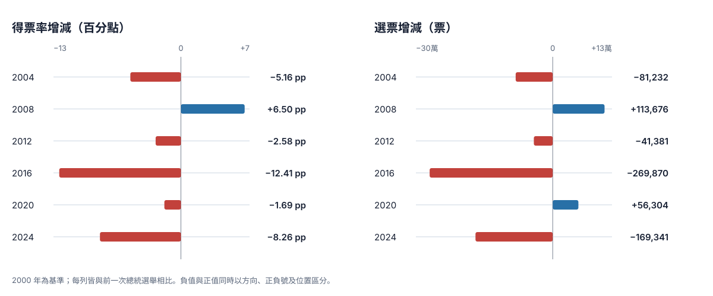
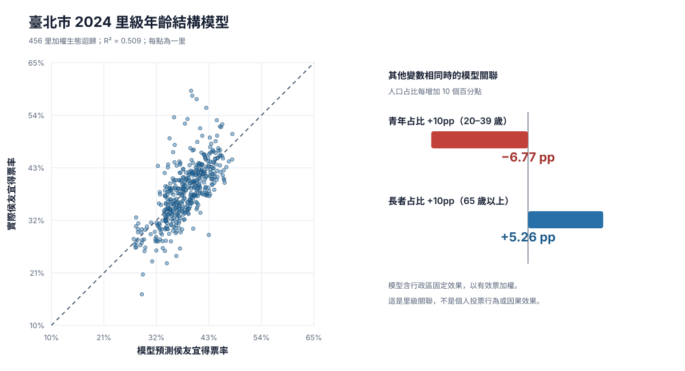

# Taipei Blue Vote Trend

台北市 2000–2024 年總統選舉泛藍票倉趨勢：可重現資料、分析程式、眷村所在地代理比較、青年補票估計與圖表。



## 主要發現

| 指標 | 2000 | 2024 | 變化 |
|---|---:|---:|---:|
| 台北市泛藍票 | 979,102 | 587,258 | −391,844（−40.0%） |
| 台北市泛藍得票率 | 61.69% | 38.08% | −23.60 個百分點 |
| 固定深藍 cohort 泛藍票 | 391,330 | 218,485 | −172,845（−44.2%） |
| 固定深藍 cohort 泛藍率 | 69.66% | 43.72% | −25.94 個百分點 |

固定深藍 cohort 定義為：2000 年至少 100 張有效票、泛藍率至少 65%，且 2000–2024 七屆皆能以相同「行政區＋里名」配對的里，共 146 里。

變化並非固定速度下降，而是「高檔震盪後階梯式下移」：2016 年是最大斷層（−12.41 個百分點、−269,870 票），2024 年是第二次大幅下移（−8.26 個百分點、−169,341 票）。2020 年票數增加 56,304 票，但占比仍下降 1.69 個百分點，顯示票數與相對支持度必須分開看。

## 泛藍口徑

| 年份 | 計入候選人 |
|---|---|
| 2000 | 宋楚瑜、連戰 |
| 2004 | 連戰 |
| 2008 | 馬英九 |
| 2012 | 馬英九、宋楚瑜 |
| 2016 | 朱立倫、宋楚瑜 |
| 2020 | 韓國瑜、宋楚瑜 |
| 2024 | 侯友宜 |

柯文哲票只在 2024 年資料中另列為非綠參考，不計入泛藍主序列。

## 青年補票估計

2024 年台北市 20–39 歲選舉人共 571,536 人。以約 71.5% 投票率及分齡民調支持區間估算，投給侯友宜約 55,168–65,384 票，中央值 61,297 票，相當於補回 2000–2024 泛藍票數流失的約 14.1%–16.7%。

這不是官方候選人×年齡交叉表，也不是個人層次的投票識別。秘密投票下，該數字只能是結合官方人口／投票率與調查支持率的區間估計。

## 里級年齡結構模型



以戶政司 2023 年 12 月單一年齡人口與 2024 年總統票作行政區＋里別精確配對，456／456 里全數命中。有效票加權生態迴歸含行政區固定效果，加權 R² 為 0.509。

- 20–39 歲占比每高 10 個百分點，模型中侯友宜得票率約低 6.77 個百分點。
- 65 歲以上占比每高 10 個百分點，模型中得票率約高 5.26 個百分點。
- 每里的實際／預測得票率、預測票數、殘差與排名均在 `village_age_structure_2024.csv`。

這是同一時點的里級關聯模型，適合用來建立「單看年齡結構預期多藍」的基準線；不可解釋為個人因果，也不能單獨分解 2000–2024 的死亡、遷移或世代交替。

## 重建

需要 Python 3.11 以上，沒有第三方 runtime dependency。

```bash
PYTHONPATH=src python3 -m taipei_blue_vote --refresh
PYTHONPATH=src python3 -m unittest discover -s tests -v
```

原始 CSV 下載至 gitignored 的 `data/raw/`。程式會重建：

- `data/derived/city_trend.csv`
- `data/derived/deep_blue_cohort.csv`
- `data/derived/election_deltas.csv`
- `data/derived/military_village_proxies.csv`
- `data/derived/young_replacement.csv`
- `data/derived/source_manifest.json`
- `data/derived/village_age_structure_2024.csv`
- `data/derived/age_model_2024.csv`
- `data/derived/age_source_manifest.json`
- `charts/taipei-blue-election-deltas.svg`
- `charts/taipei-blue-election-deltas.html`
- `charts/village-age-model-2024.svg`
- `charts/village-age-model-2024.html`

## 資料來源

- [中選會選舉資料庫](https://db.cec.gov.tw/Visual)
- [TaiwanVotes CSV 下載與資料出處](https://taiwanvotes.tw/download/)：依中選會開放資料正規化；逐檔 URL、SHA-256、位元組數與列數見 source manifest。
- [中選會 2024 年選舉人年齡統計](https://web.cec.gov.tw/api/file/5f9a0a37-3df1-46a7-afcb-8fff36f1d800.pdf)
- [中選會年齡投票率研究](https://web.cec.gov.tw/api/file/c67a1f6c-544a-4065-ac96-ce53f183de5c.pdf)
- [TVBS 2023-12-22 分齡民調](https://cc.tvbs.com.tw/portal/file/poll_center/2023/20231222/adc5c803a4f2bbc2193a44e2b74f7492.pdf)
- [聯合報 2023-11-28 分齡民調](https://paper.udn.com/udnpaper/PID0001/390092/web/)
- [戶政司：村里戶數、單一年齡人口](https://data.gov.tw/dataset/77132)：本專案使用 2023 年 12 月 `ODRP014` API；快照 URL、SHA-256 與位元組數見 age source manifest。

完整方法、眷村代理里結果與限制見 [`report/findings.md`](report/findings.md)。

## 重要限制

- 泛藍是本專案的透明分類，不是中選會官方分類。
- 里級彙總資料不能識別個人投票，也不能單獨區分死亡、遷移、都市更新、投票率與政黨轉向。
- 年齡模型是使用 2024 同屆選舉估計的描述基準，不是樣本外預測或因果識別。
- 眷村所在地代理里反映的是地理範圍，不等於眷村後代人口。
- 精確里名配對會排除改名、分里或合併的里，換取較可解釋的固定 cohort。

## License

程式碼採 MIT License。資料仍依各原始提供者的授權與註明方式使用。
