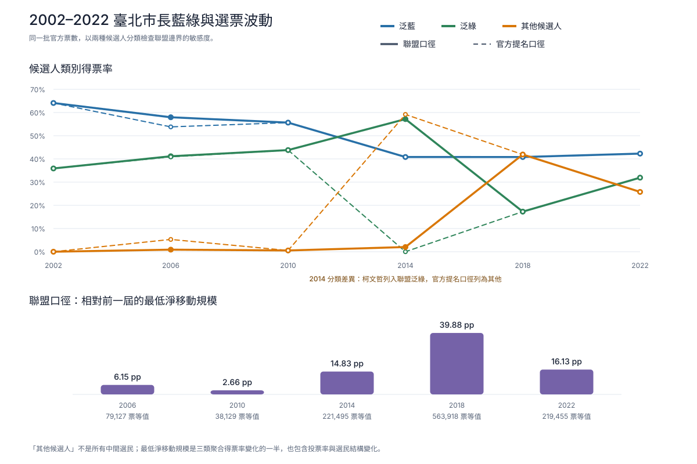
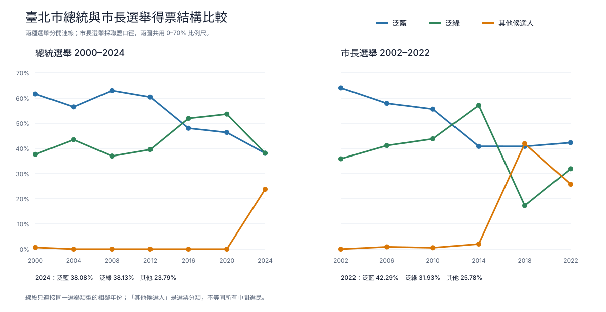
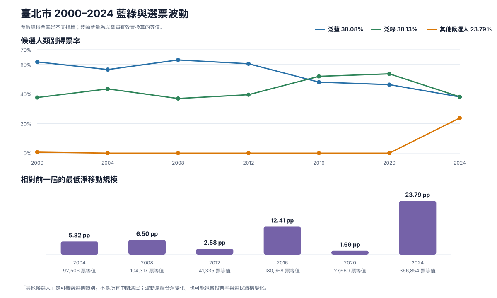

# 台北市藍綠基本盤與選票波動：總統 2000–2024、市長 2002–2022

## 核心結論

> 26 年來，台北由明顯的藍大於綠，轉變為藍綠政黨候選人幾乎五五波。
> 因此，2026 年台北選舉不宜再以「藍營天然大於綠營」作為預設；較符合
> 資料的結構是藍綠各有約四成競爭盤，剩餘第三勢力與中間選民決定勝負。

2000 年總統選舉，泛藍為 979,102 票（61.6887%），泛綠為 597,465 票
（37.6435%）；到了 2024 年，藍為 587,258 票（38.0839%），綠為 587,899
票（38.1255%），只差 641 票。若只在藍綠兩者合計中重新標準化，比例為
藍 49.9727%、綠 50.0273%。這證明藍綠政黨候選人票已近乎平手，但不能把
柯文哲的 366,854 票（23.7906%）預先分給任何一方，也不能把「五五波」
解讀成藍綠各有固定 50% 基本盤。

長期端點顯示兩邊走勢不同。泛藍 2000–2024 少 391,844 票、下降 23.6048
個百分點；2024 年 20–39 歲侯友宜票估計只能補回這段淨流失的約
14.1%–16.7%，青年補票速度不足以抵銷長期流失。固定深藍里、眷村所在地
代理與年齡模型都與高齡藍營人口老化後優勢減弱的方向一致，但資料無法把
死亡、搬遷、都更、投票率、候選人效果與政黨轉向分別識別，不能把全部跌幅
單獨歸因於長者凋零。

泛綠同期只少 9,566 票（−1.6%），得票率反而增加 0.4820 個百分點，因此
長期端點可描述為大致持平。這與舊支持者退出及新進支持者補入後接近互抵的
解釋相容，但不是兩者恰好一比一抵銷的直接證明；2016、2020 的上升與 2024
的下降也顯示泛綠路徑本身有明顯波動。

## 台北市長選舉結論

選舉聯盟口徑下，台北市長藍方由 2002 年 873,102 票（64.1085%）降至 2022 年 575,590 票（42.2932%），淨減 297,512 票、21.8153 個百分點。固定 202 個深藍里也由 453,740 票（71.3291%）降至 286,191 票（46.5363%），減少 167,549 票、24.7928 個百分點。兩者都顯示長期藍票優勢下移，但逐屆路徑不是固定速度或單一老化曲線。

最近三屆國民黨市長候選人得票率為連勝文 40.8242%、丁守中 40.8168%、蔣萬安 42.2932%，最高與最低只差 1.4764 個百分點。這組結果支持「四成多的穩定競爭盤」，不支持把國民黨市長票直接視為天然過半。

2014 年柯文哲的 853,983 票（57.1591%）在主分析中歸入民進黨支持的選舉聯盟。它顯示綠方政黨票加上中間、第三勢力與跨陣營選民可以形成接近六成的市長勝選聯盟；它不是民進黨單獨基本盤，更不能從一次聯盟選舉推論固定的「民進黨天花板」。

### 兩種候選人分類

主分析採「選舉聯盟口徑」，因為它較接近每一屆實際的藍綠對決結構；「官方提名口徑」只計國民黨與民進黨正式提名人，用來呈現分類敏感度。兩者都是分析分類，不是中選會官方欄位。

選舉聯盟口徑：

| 年份 | 藍方 | 綠方 | 其他 |
|---|---|---|---|
| 2002 | 馬英九 | 李應元 | — |
| 2006 | 郝龍斌、宋楚瑜 | 謝長廷、周玉蔻 | 李敖、柯賜海 |
| 2010 | 郝龍斌 | 蘇貞昌 | 吳炎成、蕭淑華、吳武明 |
| 2014 | 連勝文 | 柯文哲 | 陳汝斌、趙衍慶、李宏信、陳永昌、馮光遠 |
| 2018 | 丁守中 | 姚文智 | 柯文哲、吳蕚洋、李錫錕 |
| 2022 | 蔣萬安 | 陳時中 | 張家豪、王文娟、鄭匡宇、黃聖峰、童文薰、蘇煥智、黃珊珊、施奉先、唐新民、謝立康 |

官方提名口徑：

| 年份 | 國民黨提名人 | 民進黨提名人 | 其他 |
|---|---|---|---|
| 2002 | 馬英九 | 李應元 | — |
| 2006 | 郝龍斌 | 謝長廷 | 宋楚瑜、周玉蔻、李敖、柯賜海 |
| 2010 | 郝龍斌 | 蘇貞昌 | 吳炎成、蕭淑華、吳武明 |
| 2014 | 連勝文 | —（民進黨未提名） | 柯文哲、陳汝斌、趙衍慶、李宏信、陳永昌、馮光遠 |
| 2018 | 丁守中 | 姚文智 | 柯文哲、吳蕚洋、李錫錕 |
| 2022 | 蔣萬安 | 陳時中 | 張家豪、王文娟、鄭匡宇、黃聖峰、童文薰、蘇煥智、黃珊珊、施奉先、唐新民、謝立康 |

官方提名口徑的 2014 綠票為零，只表示民進黨沒有正式提名候選人，不表示當年沒有泛綠選民，也不能當作泛綠基本盤。

### 全市得票：選舉聯盟口徑

| 選舉 | 有效票 | 藍方票（率） | 綠方票（率） | 其他票（率） |
|---|---:|---:|---:|---:|
| 2002 | 1,361,913 | 873,102（64.1085%） | 488,811（35.8915%） | 0（0.0000%） |
| 2006 | 1,286,089 | 745,366（57.9560%） | 529,241（41.1512%） | 11,482（0.8928%） |
| 2010 | 1,433,736 | 797,865（55.6494%） | 628,129（43.8106%） | 7,742（0.5400%） |
| 2014 | 1,494,046 | 609,932（40.8242%） | 853,983（57.1591%） | 30,131（2.0167%） |
| 2018 | 1,413,870 | 577,096（40.8168%） | 244,342（17.2818%） | 592,432（41.9014%） |
| 2022 | 1,360,951 | 575,590（42.2932%） | 434,558（31.9305%） | 350,803（25.7763%） |

### 全市得票：官方提名口徑

| 選舉 | 有效票 | 藍方票（率） | 綠方票（率） | 其他票（率） |
|---|---:|---:|---:|---:|
| 2002 | 1,361,913 | 873,102（64.1085%） | 488,811（35.8915%） | 0（0.0000%） |
| 2006 | 1,286,089 | 692,085（53.8131%） | 525,869（40.8890%） | 68,135（5.2978%） |
| 2010 | 1,433,736 | 797,865（55.6494%） | 628,129（43.8106%） | 7,742（0.5400%） |
| 2014 | 1,494,046 | 609,932（40.8242%） | 0（0.0000%） | 884,114（59.1758%） |
| 2018 | 1,413,870 | 577,096（40.8168%） | 244,342（17.2818%） | 592,432（41.9014%） |
| 2022 | 1,360,951 | 575,590（42.2932%） | 434,558（31.9305%） | 350,803（25.7763%） |

### 每屆增減

選舉聯盟口徑；每格為「票數增減（得票率百分點增減）」：

| 選舉 | 藍方 | 綠方 | 其他 |
|---|---:|---:|---:|
| 2006 | −127,736（−6.15 pp） | +40,430（+5.26 pp） | +11,482（+0.89 pp） |
| 2010 | +52,499（−2.31 pp） | +98,888（+2.66 pp） | −3,740（−0.35 pp） |
| 2014 | −187,933（−14.83 pp） | +225,854（+13.35 pp） | +22,389（+1.48 pp） |
| 2018 | −32,836（−0.01 pp） | −609,641（−39.88 pp） | +562,301（+39.88 pp） |
| 2022 | −1,506（+1.48 pp） | +190,216（+14.65 pp） | −241,629（−16.13 pp） |

聯盟藍最大得票率及票數跌幅都在 2014 年（−14.83 pp、−187,933 票）；最大得票率回升在 2022 年（+1.48 pp），最大票數回升在 2010 年（+52,499 票）。聯盟綠最大跌幅在 2018 年（−39.88 pp、−609,641 票）；最大得票率回升在 2022 年（+14.65 pp），最大票數增加在 2014 年（+225,854 票）。票數與占比的最大變化不一定發生於同一屆。

官方提名口徑：

| 選舉 | 藍方 | 綠方 | 其他 |
|---|---:|---:|---:|
| 2006 | −181,017（−10.30 pp） | +37,058（+5.00 pp） | +68,135（+5.30 pp） |
| 2010 | +105,780（+1.84 pp） | +102,260（+2.92 pp） | −60,393（−4.76 pp） |
| 2014 | −187,933（−14.83 pp） | −628,129（−43.81 pp） | +876,372（+58.64 pp） |
| 2018 | −32,836（−0.01 pp） | +244,342（+17.28 pp） | −291,682（−17.27 pp） |
| 2022 | −1,506（+1.48 pp） | +190,216（+14.65 pp） | −241,629（−16.13 pp） |

官方口徑最大藍跌幅同樣是 2014 年（−14.83 pp、−187,933 票），最大藍得票率與票數回升都在 2010 年（+1.84 pp、+105,780 票）。最大綠跌幅在 2014 年（−43.81 pp、−628,129 票），最大回升在 2018 年（+17.28 pp、+244,342 票）；這主要是「無正式提名→重新提名」的分類結果，不是識別出的選民流動。

### 選舉波動

三類總變異距離為藍、綠、其他得票率增減絕對值總和的一半；票數等值再乘以當屆有效票。它是聚合分布至少改變多少的尺度，不是實際轉投人數。

| 選舉 | 聯盟口徑波動 | 聯盟票數等值 | 官方口徑波動 | 官方票數等值 |
|---|---:|---:|---:|---:|
| 2006 | 6.1525 pp | 79,126 | 10.2954 pp | 132,407 |
| 2010 | 2.6595 pp | 38,129 | 4.7579 pp | 68,215 |
| 2014 | 14.8252 pp | 221,495 | 58.6358 pp | 876,046 |
| 2018 | 39.8847 pp | 563,918 | 17.2818 pp | 244,342 |
| 2022 | 16.1251 pp | 219,455 | 16.1251 pp | 219,455 |

2014、2018 的兩種波動排序互換，正好說明候選人分類會主導數值：聯盟口徑把柯文哲從 2014 綠方轉成 2018 其他，因此 2018 波動最高；官方口徑則在 2014 把柯票列入其他，該屆波動最高。

### 固定里 cohort

市長固定 cohort 僅使用選舉聯盟口徑，先用 2002 年定義一次，再追蹤至 2022：

1. 深藍里：2002 藍方得票率至少 65%，有效票至少 100；
2. 深綠里：2002 綠方得票率至少 45%，有效票至少 100；
3. 行政區＋里名必須在六屆完全相同，改名、分里或合併者排除，不做猜測式接合。

結果為 202 個深藍里與 73 個深綠里。深藍 cohort 的藍票由 453,740 降至 286,191，減少 167,549 票（36.9%）；藍率由 71.3291% 降至 46.5363%，減少 24.7928 個百分點。深綠 cohort 的綠票由 97,672 降至 78,714，減少 18,958 票（19.4%）；綠率由 49.0457% 降至 40.1823%，減少 8.8634 個百分點。兩者中間都大幅波動，不能只歸因於死亡或世代替換。

### 2006 與 2014 的分類敏感度

2006 年由官方提名改採聯盟口徑後，宋楚瑜 53,281 票（4.1429%）移入藍方，周玉蔻 3,372 票（0.2622%）移入綠方；其他由 68,135 票（5.2978%）降為 11,482 票（0.8928%），減少 56,653 票、4.4050 個百分點。

2014 年兩種口徑的藍方相同，都是連勝文 609,932 票（40.8242%）。聯盟口徑把柯文哲 853,983 票（57.1591%）列為綠方，其他只剩 30,131 票（2.0167%）；官方提名口徑的綠方為 0，柯票移入其他後，其他成為 884,114 票（59.1758%）。這個極端差異就是同時公布兩種口徑的理由。

### 與總統選舉的異同

相同之處是藍方長期端點都明顯下移：總統選舉 2000–2024 減少 391,844 票、23.6048 個百分點；市長聯盟口徑 2002–2022 減少 297,512 票、21.8153 個百分點。固定深藍里也都比全市端點跌得更深。

差異在於斷點和第三勢力的角色。總統序列主要斷點在 2016 與 2024，泛綠端點比 2000 高 0.4820 個百分點；市長序列最大候選人／聯盟重組發生在 2014–2018，聯盟綠端點反而比 2002 低 3.9610 個百分點。市長其他票在 2018 為 41.9014%、2022 為 25.7763%，總統其他票則在 2024 為 23.7906%。地方候選人、職位、投票率與競選情境不同，因此兩條序列可以並列比較，不能互換或拼成一條連續趨勢。

### 2026 TVBS 民調：第三勢力選票的補充線索

[TVBS 2026 年 5 月原始民調](https://cc.tvbs.com.tw/portal/file/poll_center/2026/20260527/87ed4a7009e43fa1cea459b7f1785f83.pdf)中，有投票意願者整體為蔣萬安 58%、沈伯洋 30%、未決定 13%；自述 2022 投黃珊珊者為蔣 61%、沈 32%。調查有效樣本 901 人，公布的全體抽樣誤差為 95% 信心水準下 ±3.3 個百分點。

[TVBS 2026 年 10 月 8 日調查](https://news.tvbs.com.tw/politics/4033530)整體為蔣 49%、沈 41%、未決定 11%；自述投黃者改為沈 53%、蔣 39%。有效樣本 1,120 人，公布的全體抽樣誤差為 ±2.9 個百分點。另一篇[同日 TVBS 交叉分析](https://news.tvbs.com.tw/politics/4033546)顯示，自述中立者由 5 月的蔣 57%、沈 14%變為 10 月的蔣 40%、沈 36%。

兩次整體比例因 TVBS 公布為整數且經四捨五入，合計會出現 101%。

這些變化與歷史聚合結果方向相容：2018→2022 的聯盟其他票減少 16.13 個百分點，綠方增加 14.65 個百分點，藍方只增加 1.48 個百分點，因此第三勢力票不能預設為固定的藍營寄放票。但兩類資料都不能識別個人流向：

- 5 月與 10 月是兩個獨立的橫斷面市話樣本，不是追蹤同一批人的 panel；「61:32 變成 39:53」同時可能包含真實態度變化與樣本組成差異。
- 公布的 ±3.3 與 ±2.9 個百分點是全體樣本誤差，不是較小的黃珊珊舊選民子群誤差；子群不確定性更高。
- 10 月有投票意願樣本只有 15%自述 2022 投黃，低於黃珊珊實際得票率 25.1398%。回憶、投票意願、未回應與樣本組成差異都可能影響比較。
- 因此不能把 53:39 機械套用到 2022 年全部 342,141 張黃珊珊票，也不能把它寫成已證明的個人轉投。

較穩健的結論是：歷史選舉與近期民調都反對「白票必然全數回藍」的簡化假設，但白票最終如何分配仍取決於候選人、競選情境、投票率與尚未決定者。Threads 文章引用的 1994、1998 市長選舉不在本專案可重現的 2002–2022 範圍內；本報告不拿未納入 pipeline 的數字補做長期結論。

### 可重現輸出

候選人明細、全市趨勢、逐屆增減、波動、兩個固定 cohort 與來源清單依序位於：

- `data/derived/mayor_candidate_totals.csv`
- `data/derived/mayor_city_trend.csv`
- `data/derived/mayor_bloc_deltas.csv`
- `data/derived/mayor_electoral_volatility.csv`
- `data/derived/mayor_deep_blue_cohort.csv`
- `data/derived/mayor_deep_green_cohort.csv`
- `data/derived/mayor_source_manifest.json`

來源 manifest 記錄六個 TaiwanVotes 正規化中選會台北市長 CSV 的檔名、URL、SHA-256、位元組數、列數、上游版本與授權。互動式 HTML 圖位於 `charts/taipei-mayor-bloc-and-volatility.html` 與 `charts/taipei-presidential-mayor-comparison.html`；同名 SVG 可直接嵌入文件。

## 總統選舉結論

台北市泛藍總統票從 2000 年的 979,102 票（61.6887%）降至 2024 年侯友宜的 587,258 票（38.0839%），淨減 391,844 票、23.6048 個百分點。這不是規律、線性的老化曲線：2008 年曾反彈，2016 與 2024 才是兩個主要結構斷點。

每屆相對前一屆：

| 選舉 | 得票率增減 | 票數增減 |
|---|---:|---:|
| 2004 | −5.16 pp | −81,232 |
| 2008 | +6.50 pp | +113,676 |
| 2012 | −2.58 pp | −41,381 |
| 2016 | −12.41 pp | −269,870 |
| 2020 | −1.69 pp | +56,304 |
| 2024 | −8.26 pp | −169,341 |

2020 年是重要反例：票數增加，但占有效票比例仍下降。因此人口與投票總量變化不能直接當成政黨支持度變化。

## 泛綠全市趨勢

泛綠候選人口徑為：2000、2004 年陳水扁，2008 年謝長廷，2012、2016、2020 年蔡英文，2024 年賴清德。泛藍分類維持原分析口徑，宋楚瑜在參選年份仍列入泛藍。

| 選舉 | 泛綠票 | 泛綠率 | 相較前屆票數 | 相較前屆百分點 |
|---|---:|---:|---:|---:|
| 2000 | 597,465 | 37.64% | — | — |
| 2004 | 690,379 | 43.47% | +92,914 | +5.82 pp |
| 2008 | 593,256 | 36.97% | −97,123 | −6.50 pp |
| 2012 | 634,565 | 39.54% | +41,309 | +2.58 pp |
| 2016 | 757,383 | 51.96% | +122,818 | +12.41 pp |
| 2020 | 875,854 | 53.65% | +118,471 | +1.69 pp |
| 2024 | 587,899 | 38.13% | −287,955 | −15.53 pp |

2000–2024 泛綠票淨減 9,566 票（−1.6%），得票率則增加 0.4820 個百分點。長期端點看似穩定，但逐屆路徑波動很大：2016 年是最大得票率增加，2024 年則是票數與得票率的最大下降。

## 固定深綠里 cohort

採用與深藍 cohort 相同的固定追蹤方法：2000 年有效票至少 100、泛綠率至少 45%，並且七屆皆可用相同行政區與里名精確配對。共得到 86 里。

這批里的泛綠票由 2000 年 142,725 票、49.2508%，降至 2024 年 122,604 票、45.5416%，減少 20,121 票（−14.1%）及 3.7092 個百分點。2020 年曾達 181,620 票、63.2686%，因此同樣不是平滑或單向的世代趨勢。

## 其他候選人與三陣營選舉波動

「其他候選人」定義為不在上述泛藍或泛綠分類中的候選人：2000 年為許信良、李敖，共 10,599 票（0.67%）；2004–2020 年因所有候選人皆已歸入藍綠兩類，所以是結構性的 0；2024 年為柯文哲，共 366,854 票（23.79%）。它是可直接觀察的候選人分類，不等於所有中間選民。

為描述藍、綠、其他三類選票分布每屆至少改變多少，另計算總變異距離：三類得票率增減絕對值總和的一半。乘上當屆有效票後，得到便於理解的「票數等值」。

| 選舉 | 波動 | 當屆票數等值 |
|---|---:|---:|
| 2004 | 5.8244 pp | 92,506 |
| 2008 | 6.5003 pp | 104,317 |
| 2012 | 2.5758 pp | 41,335 |
| 2016 | 12.4148 pp | 180,968 |
| 2020 | 1.6944 pp | 27,660 |
| 2024 | 23.7906 pp | 366,854 |

2024 年的波動最大，2016 年次之，沒有呈現固定週期或固定幅度。這個數值是跨屆聚合分布的最低淨移動尺度；互相抵銷的流動、投票率差異、新增與退出選民都無法由它分解，因此不能當成實際轉投者或意識形態中間選民人數。

## 固定深藍里 cohort

為避免每屆重新挑選「當屆最藍的里」造成倖存者偏誤，本分析先以 2000 年定義 cohort，再固定追蹤：

1. 2000 年有效票至少 100；
2. 2000 年泛藍得票率至少 65%；
3. 2000、2004、2008、2012、2016、2020、2024 都存在完全相同的行政區與里名。

共得到 146 里。其泛藍票由 391,330 降至 218,485，減少 172,845 票（−44.2%）；泛藍率由 69.6584% 降至 43.7204%，減少 25.9380 個百分點。這批里占全市泛藍票數淨流失的 44.1%。

## 眷村所在地代理

四個自 2000 可連續比較的所在地代理里是：

- 四四南村：信義區景新里；
- 四四西村／忠駝國宅：信義區西村里；
- 中心新村：北投區林泉里；
- 嘉禾新村：中正區富水里。

四里合計由 2000 年 7,746 泛藍票、75.02%，降至 2024 年 4,178 票、46.25%；票數減少 46.1%，得票率減少 28.77 個百分點。

煥民新村位於大安區學府里。由於本資料無法從 2000 連續配對，因此從 2004 年另列；泛藍率由 69.15% 降至 2024 年 46.17%。官方資料也記錄原列管眷戶搬遷，因此這些地理變化不能只歸因於死亡。

所在地查證來源：

- [臺北市文化局：蟾蜍山煥民新村](https://culture.gov.taipei/cp.aspx?n=66A2914C14F403C7&s=71D561BD069EB0D5)
- [臺北市大安區學府里](https://dado.gov.taipei/News_Content_VillageLeader.aspx?n=BE0A98AD330074FB&s=D910A2B96A4A9194&sms=D982815F3A372FF5)
- [退輔會：煥民新村原眷戶搬遷紀錄](https://epaper.vac.gov.tw/zh-tw/C/3109%7C22/32460/1/Publish.htm)

## 青年補票估計

2024 年台北市 20–39 歲選舉人為 571,536 人；這批人在 2000 年皆未達總統選舉投票年齡，可作為「相對 2000 的新進選民」範圍。以約 71.5% 投票率推估約 408,648 張選票，再用分齡民調推定侯友宜支持區間：

- 低估：55,168 票；
- 中央估計：61,297 票；
- 高估：65,384 票。

相對於全市 391,844 票的淨流失，補回比例約 14.1%–16.7%。換句話說，年輕支持者確實存在，但規模不足以抵消長期淨流失。

這個估計包含所有年輕侯票，不能進一步識別哪些是眷村第二代、家庭政治傳承或新近轉向。

## 從每里人口年齡結構估計票倉

可以做「生態層級的模型估計」。本分析將戶政司 2023 年 12 月[「村里戶數、單一年齡人口」](https://data.gov.tw/dataset/77132)與 2024 總統選舉以「行政區＋里名」精確配對，456／456 里全數匹配。因變數為侯友宜票占有效票比例，自變數為 20–39 歲占比、65 歲以上占比與行政區固定效果，並以各里有效票加權。

模型結果：

- 加權 R² = 0.509，即這組變數在模型內解釋約一半的里間加權得票率差異；
- 20–39 歲占比每高 10 個百分點，侯得票率約低 6.77 個百分點；
- 65 歲以上占比每高 10 個百分點，侯得票率約高 5.26 個百分點。

按模型預測得票率排序的前五里：

| 行政區 | 里 | 20–39 歲 | 65+ | 預測侯票率 | 預測侯票 | 實際侯票率 |
|---|---|---:|---:|---:|---:|---:|
| 文山區 | 興業里 | 23.49% | 27.04% | 47.90% | 1,586 | 50.08% |
| 文山區 | 萬盛里 | 22.04% | 25.14% | 47.87% | 1,401 | 44.76% |
| 大安區 | 仁愛里 | 17.58% | 29.54% | 47.17% | 1,290 | 44.33% |
| 文山區 | 景華里 | 21.37% | 21.95% | 46.65% | 1,598 | 43.14% |
| 大安區 | 昌隆里 | 21.24% | 32.59% | 46.30% | 850 | 39.87% |

這是「單看年齡結構加行政區時預期多藍」的基準，不是實際票倉清單。例如實際得票率最高的中山區劍潭里為 59.14%，年齡模型僅預測 39.27%，高出模型 19.87 個百分點；這類殘差正反映年齡以外的地方、社群、候選人或歷史因素。

完整 456 里的實際票數、模型預測票數、得票率、殘差與排名見 `data/derived/village_age_structure_2024.csv`；圖表見 `charts/village-age-model-2024.svg`。

## 為何不把侯友宜與柯文哲相加

若把 2024 年侯友宜與柯文哲都算為「非綠」，合計比例為 61.87%，表面上接近 2000 年泛藍 61.69%。但民眾黨選民的世代、政黨認同與候選人選擇不等同傳統泛藍，因此主分析不把柯票算成藍營補票；`city_trend.csv` 仍保留柯票欄位供比較。

## 可識別與不可識別

可以由資料直接計算：各屆、各里的候選人票數，藍綠及其他候選人的彙總票數，固定 cohort 的得票率與票數變化，以及眷村所在地代理里的地理變化。

不能由里級彙總結果直接識別：個人年齡與投票選擇、死亡造成的票數、搬家前後同一人的選擇、眷村後代的個別投票，或誰是意識形態上的中間選民。本專案的三陣營波動只能量出聚合分布最低限度的變化；年齡模型也只能估計人口結構與藍票率的里級關聯，不能把相關性解釋成個人因果。
